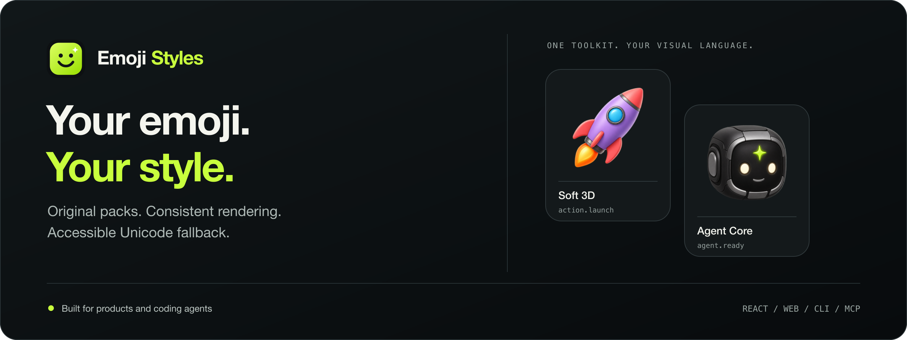
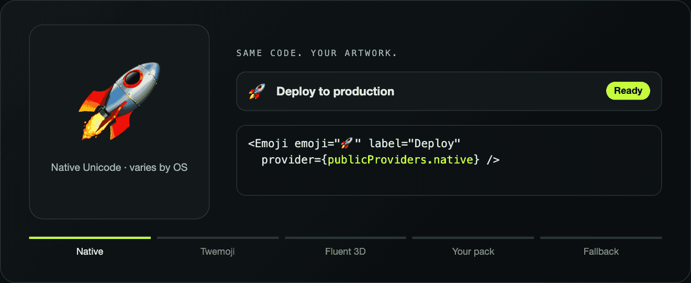
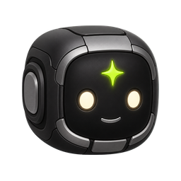

<p align="center">
  
</p>

<h1 align="center">Emoji Styles</h1>

<p align="center">Custom emoji packs, consistent rendering, accessible Unicode fallback.</p>

<p align="center">
  <a href="https://emoji-styles.space">Explore the demo</a> ·
  <a href="./docs/QUICKSTART.md">Build your first pack</a> ·
  <a href="./docs/GUIDE.md">API &amp; provider guide</a>
</p>

<p align="center">
  <a href="https://www.npmjs.com/package/emoji-styles-cli"></a>
  <a href="https://github.com/Blancochuy/emoji-styles/actions/workflows/ci.yml"></a>
  <a href="./LICENSE"></a>
</p>

Emoji Styles separates meaning from artwork. Keep `🚀` or a semantic token such
as `action.deploy` in your application, then resolve it through an open provider
or your own images. Change the visual language without rewriting product copy.

<p align="center">
  
</p>

| Bring your artwork | Choose an open style | Work with an agent |
| --- | --- | --- |
| Normalize and package your own images. | Render Fluent, Noto, Twemoji and more. | Use structured CLI and MCP tools. |
| [Custom-pack quickstart](./docs/QUICKSTART.md) | [Provider guide](./docs/GUIDE.md#providers) | [Agent setup](./docs/MCP.md) |

## Start with your own images

| 01 · Prepare | 02 · Package | 03 · Render |
| --- | --- | --- |
| Your transparent images, normalized to one canvas. | Images, manifest, hashes and provenance in one portable folder. | Your artwork in the app, with an accessible fallback. |

The CLI checks file format, alpha, bounds, mappings and hashes, then packages the
images with a manifest and provenance. React and universal web bindings render
them with accessible labels and a fallback when artwork is unavailable.

Follow the [one-page custom-pack quickstart](./docs/QUICKSTART.md). It covers
initialization, packaging, actual-size review and a React integration. No image
model, API key or generation credits are required for existing artwork.

CLI **0.3.0** packages artwork in one command with `assets pack`:

```sh
npm install --save-dev emoji-styles-cli@0.3.0
```

Upgrade from CLI 0.1.0 before building packs; that older version omits image copies.
MCP 0.1.0 is independently published.

## A visual language of your own

These are existing custom-artwork examples from the demo. Each is a separate
visual direction, with its own manifest and provenance.

<table>
  <tr>
    <th>Agent Core</th>
    <th>Soft 3D</th>
    <th>Clay Pop</th>
    <th>Classic Gloss</th>
  </tr>
  <tr>
    <td align="center"></td>
    <td align="center"></td>
    <td align="center"></td>
    <td align="center"></td>
  </tr>
</table>

Use any original direction; these examples are starting points. Review the
[artwork provenance](./demo/src/custom-emoji) and [licensing policy](./docs/LICENSE_POLICY.md)
before reuse. Source-code MIT licensing does not establish artwork rights.

## Use an existing provider

```sh
npm install react-emoji-styles
```

```tsx
import { Emoji, publicProviders } from "react-emoji-styles";
import "react-emoji-styles/styles.css";

export function Launch() {
  return <Emoji emoji="🚀" provider={publicProviders.fluent3d} label="Launch" size={32} />;
}
```

Choose Fluent, Noto, Twemoji, SerenityOS pixel art, local assets or native Unicode.
Coverage and licenses vary by provider; see the [provider guide](./docs/GUIDE.md#providers).

## Keep a closed token set small

For reviewed product tokens, CLI 0.3.0 can resolve a theme at build time. Runtime
0.2.0 renders the result without bundling the full Unicode catalog:

```sh
npm install emoji-styles@^0.2.0 react-emoji-styles@^0.2.0
npm install --save-dev emoji-styles-cli@0.3.0
npx --no-install emoji-styles theme compile ./emoji-theme.json --output ./src/emoji-theme.compiled.ts --yes
```

```tsx
import { CompiledEmojiToken } from "react-emoji-styles/compiled";
import "react-emoji-styles/styles.css";
import { compiledEmojiTheme } from "./emoji-theme.compiled";

<CompiledEmojiToken token="action.deploy" theme={compiledEmojiTheme} size={20} />;
```

Create and review the theme first; see [compiled themes](./docs/SEMANTIC_TOKENS.md#compiled-themes)
for input formats, fallbacks and freshness checks. Use the full renderer for
arbitrary Unicode/user content or live provider switching. Mixing both entry
points may retain the catalog. [Reproduce the bundle comparison](./benchmarks/runtime-bundle).

## For coding agents

The published [CLI](./docs/CLI.md) and [local MCP server](./docs/MCP.md) expose
structured resolution, audits, asset validation and generation plans. Repository
skills guide integration and original artwork creation. Read [AGENTS.md](./AGENTS.md)
and the [skills guide](./docs/SKILLS.md).

Image generation runs through the agent's available tool. The renderer and
asset pipeline do not execute image models or charge for generation. Technical
validation does not establish visual quality: review legibility, meaning and style
at interface sizes before accepting artwork.

## Explore further

- [Custom assets and provenance](./docs/CUSTOM_ASSETS.md)
- [Semantic tokens](./docs/SEMANTIC_TOKENS.md)
- [Universal web integration](./docs/WEB.md)
- [CLI commands and Studio](./docs/CLI.md)
- [Standalone consumer example](./examples/agent-status)
- [Architecture, scope and known limits](./docs/READINESS.md)
- [Demo walkthrough](./docs/DEMO.md)

## Develop

Node.js 18+ and pnpm 10 are required; native image dependencies must be enabled.

```sh
pnpm install --frozen-lockfile
pnpm test
pnpm typecheck
pnpm build
pnpm dev
```

Source code is [MIT](./LICENSE). Artwork has separate terms; see the
[asset licensing policy](./docs/LICENSE_POLICY.md). Contributions should start
with a reproducible use case or bug report and follow [CONTRIBUTING.md](./CONTRIBUTING.md).
