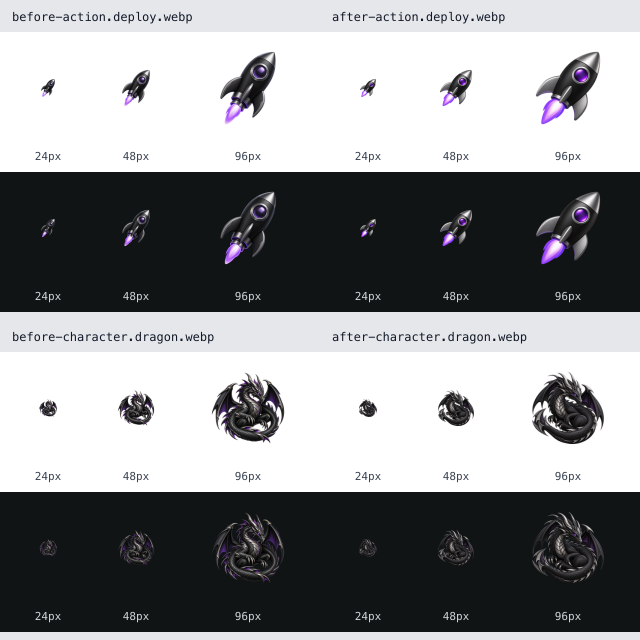
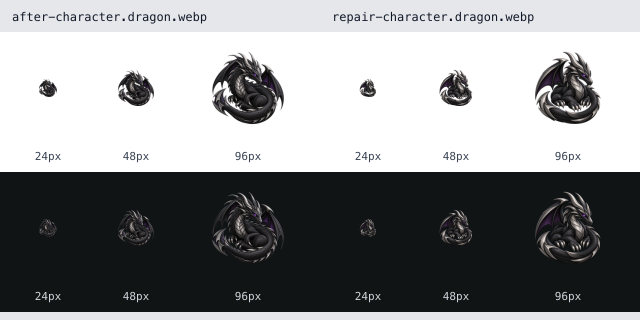

# Emoji generation quality benchmark

Technical baseline: `738076b1b3ec1267d5cd685f9496356d3808970c` (merged PR #24,
before this branch's changes). The original checkout `7af3114` used to freeze
the visual prompts has exactly the same Git tree, `680665628db5d90e7badf6032444ee0e142ef205`.
The merged revision is used for the executable benchmark so it remains reachable
from master after the old feature branch is deleted.
Date: 2026-10-22. Two distinct experiments are reported below. Neither assigns a
single percentage to overall emoji quality.

## Technical acceptance: repeatable before/after

```sh
pnpm install --frozen-lockfile
pnpm --filter emoji-styles-data build
pnpm --filter emoji-styles build
pnpm benchmark:emoji-quality
```

Use Node 20+ for this harness. The loader uses `node --import tsx`; it does not
open the tsx CLI's IPC server. The baseline commit must exist locally (use a full
clone or fetch the revision). CI retrieves full history and runs this benchmark.
An alternate baseline can be supplied as `pnpm benchmark:emoji-quality --baseline <ref>`.

The harness materializes the historical asset-pipeline sources into a temporary
directory beside installed dependencies, feeds both versions the exact same
synthetic fixture bytes, and removes its scratch directory in `finally`. It does
not check out, reset, or otherwise modify the working tree's sources. Dependencies
and the fixture generator are held constant to isolate pipeline changes. Native
codec behavior can vary between environments; Node/Sharp/libvips versions and
current source hashes are saved with the results.

| Measure | Before | After |
| --- | ---: | ---: |
| Expected acceptance decisions | 3 / 13 | 13 / 13 |
| Invalid packs accepted | 10 | 0 |
| Valid packs rejected | 0 | 0 |

Cases cover valid packs at two sizes, opaque rectangular artwork, empty images,
extension mismatch, duplicate artwork, mixed sizes, duplicate emoji/token keys,
missing mapping targets, missing Unicode fallbacks, edge contact, and corrupt
input. The fixture set deliberately exercises known defects and is not a random
sample of production artwork. These numbers demonstrate technical regression
coverage, not a visual-quality improvement or general bug-detection rate.

Full outcomes: [results/technical.json](results/technical.json).

## Visual prompt pilot: frozen outputs

`visual-protocol.json` freezes four prompts before generation: two subjects
(rocket and curled full-body dragon), two conditions, one attempt per condition.
The old condition uses the baseline skill's prompt pattern; the new condition
uses `planEmojiGeneration` with the same art direction. It tests prompt changes,
not the complete anchor-reference-selection workflow of either skill.

All requests used the built-in Codex `image_gen` tool with
`transparent_background: true`, no reference images, and no explicitly selectable
seed/model ID. The model identifier and seed remain null rather than guessed.
Actual source dimensions are recorded; the tool does not expose identical size
controls for this experiment. Outputs are normalized identically to 256px,
lossless WebP, safe area 0.76. No candidate is discarded or regenerated inside
the paired A/B comparison.

The four raw PNGs have actual transparent pixels and alpha 0 in all four corners.
No background removal or chroma key was applied. Normalization only crops
transparent bounds, resizes, centers, and encodes. See `results/visual-assets.json`
for native-alpha evidence, hashes, provenance, and technical checks.

Rebuild normalized assets and review PNG from the saved raw sources, without
generating images or spending credits:

```sh
pnpm benchmark:emoji-visual
```



At 100% zoom, the new rocket has broader, simpler forms and a more visible
window/flame, while both rockets remain recognizable. Both dragon attempts still
lose readable shape on dark at 24px. The new dragon has fewer fine spikes, but
this is insufficient for acceptance at that size. All four pass the technical
validator, demonstrating why a visual gate is necessary.

These are unblinded qualitative judgments by the assistant that implemented the
changes, not independent human ratings. Two subjects and one attempt per cell
cannot establish a statistically reliable visual gain. The runtime demo artwork
was not replaced. Any post-review correction is recorded separately and excluded
from this paired comparison.

One additional targeted edit of the new dragon tests the review/correction loop.
It removes much of the fine scale texture and improves separation of the head,
feet, and tail at 48px. Reading the subject on dark at 24px remains uncertain;
the asset stays in `revise` and no further attempts were made. This extra edit
is excluded from the paired A/B result. Its exact edit prompt and input are in
`repair-protocol.json`; all five candidates, including unresolved results, have
explicit decisions in `results/visual-review.json`.



For a broader study: expand to about 20 subjects spanning faces, symbols,
objects, complex silhouettes, and dark materials; run multiple attempts with the
same budgets; randomize labels and collect independent preferences. Measure
attempts per accepted asset and cost/latency when the chosen provider exposes
them. Native-alpha support does not replace semantic or visual review.

## Artwork and provenance

These original generated images are research/review artifacts, not a released
runtime emoji pack. Their ownership and redistribution status require user
confirmation. The repository's MIT source-code license does not itself establish
rights in generated artwork. Prompts, raw files, normalized files, and measured
hashes remain together so reviewers can inspect the actual evidence.

## Next study

The broader multi-style protocol is prepared in [visual-quality](../visual-quality/README.md).
It preserves this pilot as historical exploratory evidence; it contains no new
generated artwork or quality-improvement claims.
